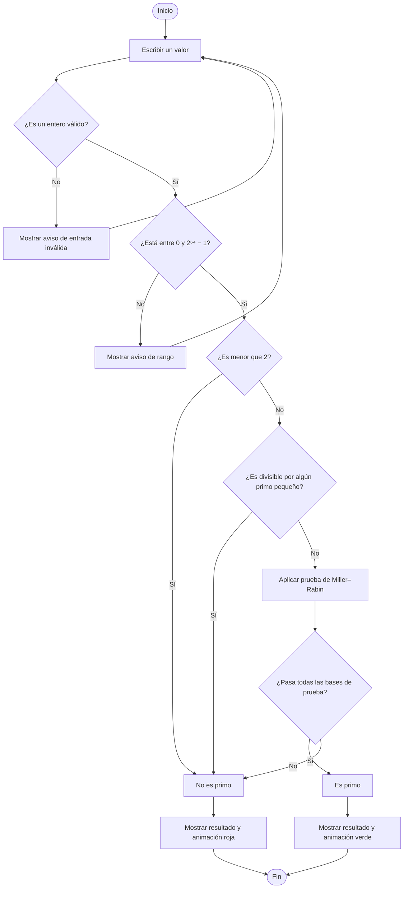

# ¿Es un número primo?

Aplicativo web sencillo para comprobar si un número entero es primo. Escribe un número, pulsa **Comprobar** y observa el resultado: la interfaz muestra una animación verde para los primos y una roja para los que no lo son.

## Cómo usarlo

1. Descarga o clona este repositorio.
2. Abre `index.html` en un navegador web.
3. Escribe un entero entre `0` y `18 446 744 073 709 551 615`.
4. Pulsa **Comprobar**.

No requiere instalación ni conexión a internet.

## Diagrama de flujo

Este diagrama se visualiza directamente en GitHub mediante Mermaid.



## Pseudocódigo

```text
leer valor

si valor no contiene un entero válido:
    mostrar aviso de entrada inválida
si no, si valor está fuera del rango de 0 a 2⁶⁴ − 1:
    mostrar aviso de rango
si no, si valor es menor que 2:
    mostrar «no es primo»
si no, si valor es divisible por un primo pequeño:
    mostrar «no es primo»
si no:
    aplicar Miller–Rabin con bases deterministas para enteros de 64 bits
    si pasa todas las bases:
        mostrar «es primo»
    si no:
        mostrar «no es primo»
```

La prueba de Miller–Rabin permite revisar también números grandes sin probar uno por uno todos sus posibles divisores. El conjunto de bases usado hace que la comprobación sea determinista para el rango de enteros sin signo de 64 bits aceptado por el aplicativo.
